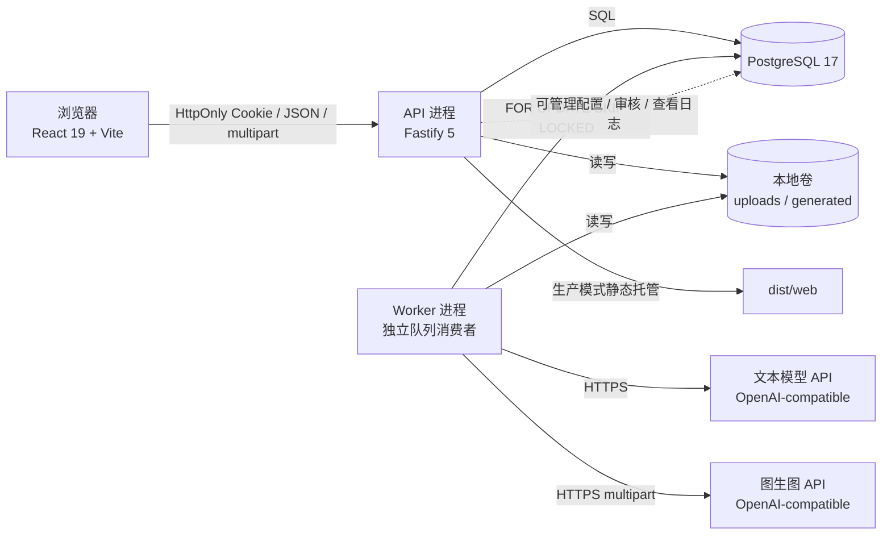
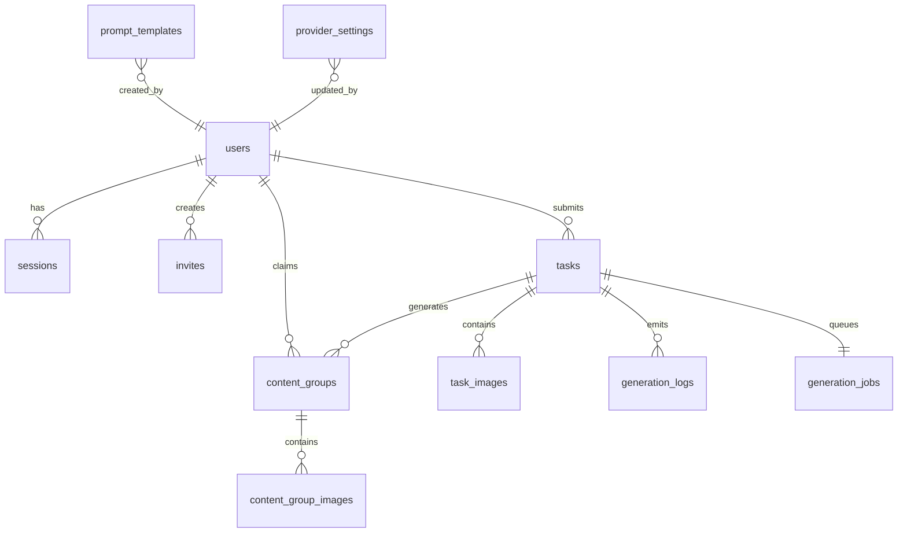
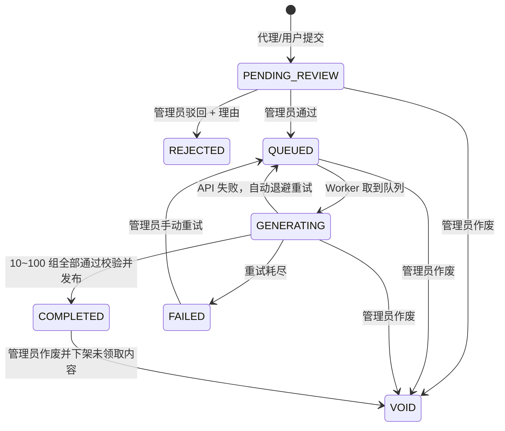
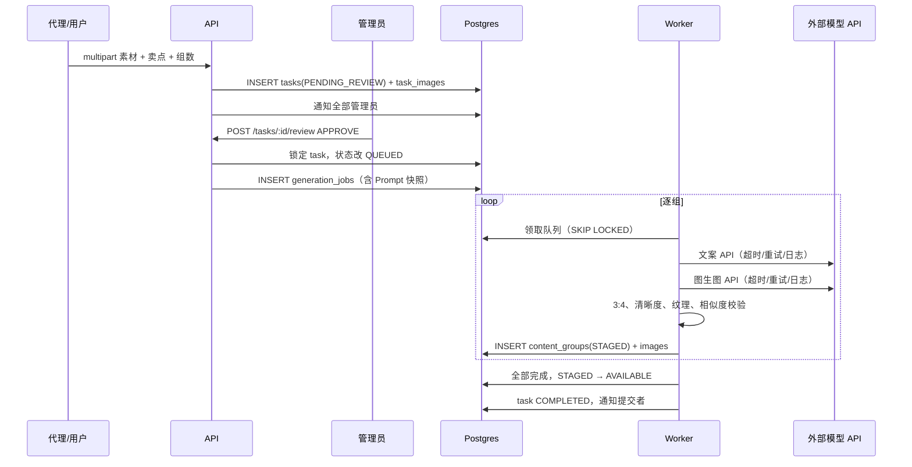
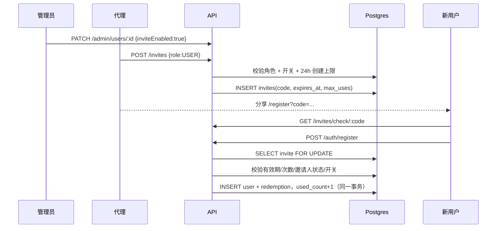

# 系统架构与实现说明

## 1. 系统定位

拾味内容中台是一套**人工审核前置的探店素材批量变体与独占领取系统**：

- 代理 / 普通用户上传原始素材与原文案，设置 10–100 组。
- 可先从大众点评公开笔记导入标题、正文与首图到可编辑表单；解析由独立服务完成，此步不创建任务、不触发生成。
- 任务进入待审队列，管理员审核通过后才创建生成队列。
- 独立 Worker 逐组调用外部文案大模型和图生图 API，做质量 / 相似度校验。
- 生成内容先以 `STAGED` 暂存，全部完成后统一转 `AVAILABLE` 进入公共池。
- 全部用户（含提交者）都可浏览公共池；每组内容只允许被一个用户领取。
- 领取后内容下架，领取人可下载 ZIP（变体图片 + 独立文案 txt）。

系统不保证大众点评 / 小红书平台过审；合规责任由分发者承担，登录页、提交页与页脚均有提示。

## 2. 部署拓扑



- **API 进程**与 **Worker 进程**分离，但共用同一个业务数据库与数据目录。
- 生产环境由 API 进程直接托管构建后的前端静态文件；也可在外层加 Nginx / Caddy 处理 TLS。
- 单 API + 单 Worker 是默认部署形态。多个 Worker 可通过 `SKIP LOCKED` 安全并行；多 API 实例需要考虑把进程内限流替换为 Redis 限流。
- 不依赖 Redis、消息队列或对象存储，适合小团队单机部署。

## 3. 角色与权限

| 能力 | 管理员 ADMIN | 代理 AGENT | 普通用户 USER |
| --- | :---: | :---: | :---: |
| 创建代理 / 普通用户 | ✅ | ❌ | ❌ |
| 邀请代理 | ✅ | ❌ | ❌ |
| 邀请普通用户 | ✅ | ✅（需管理员开启开关） | ❌ |
| 提交素材任务 | ❌ | ✅ | ✅ |
| 审核 / 驳回 / 作废任务 | ✅ | ❌ | ❌ |
| 浏览内容池 | ✅（只读） | ✅ | ✅ |
| 领取内容 / 下载 ZIP | ❌ | ✅ | ✅ |
| 查看本人 / 名下用户任务 | 全部 | 自己 + 名下普通用户 | 仅自己 |
| 查看生成日志 | 全站 | 权限范围内任务 | 权限范围内任务 |
| API Key / Prompt 配置 | ✅ | ❌ | ❌ |

硬性约束：

1. 普通用户没有任何邀请接口与入口。
2. 代理只能创建 `USER` 角色邀请码；即使伪造请求，服务端也会返回 403。
3. 代理邀请权限关闭后，不能创建新码，已有码也会在注册校验时暂停生效。
4. 管理员始终可邀请代理与普通用户，但不能通过创建账号接口创建管理员（防止越权扩散）。
5. 所有对象级读取都做归属校验，而不是只做路由级角色校验。

## 4. 数据模型



核心表（完整 DDL 见 `server/schema.sql`）：

| 表 | 作用 | 关键约束 / 索引 |
| --- | --- | --- |
| `users` | 三级角色账号、代理邀请开关 | 邮箱唯一；角色 CHECK；代理以外 `invite_enabled` 必须 false |
| `sessions` | 不透明会话令牌哈希 | token_hash 唯一；过期时间索引 |
| `invites` | 邀请码、有效期、次数、撤销 | code 唯一；`used_count <= max_uses` |
| `invite_redemptions` | 注册兑换记录 | user_id 唯一 |
| `tasks` | 素材任务、原文、卖点、状态 | 状态 CHECK；待审部分索引；驳回必须有理由 |
| `task_images` | 原图、缩略图、EXIF 已清理 | `(task_id, sha256)` 唯一，同任务不能重复图 |
| `generation_jobs` | 生成队列与进度 | task_id 唯一；`(status, available_at)` 索引 |
| `generation_logs` | 逐次 API 重试、校验、状态变化 | task/job 时间索引 |
| `content_groups` | 公共池中的一组内容 | `(task_id, group_no)` 唯一；group_code 唯一；领取状态 CHECK |
| `content_group_images` | 每组变体图片与变体参数 | `(group_id, sort_order)` 唯一 |
| `provider_settings` | 文生文 / 图生图配置，密钥 AES-GCM 加密 | kind 主键 |
| `prompt_templates` | Prompt 版本 | `(kind, version)` 唯一；每个 kind 只有一个激活版本（部分唯一索引） |
| `notifications` | 站内通知 | 未读部分索引 |
| `audit_logs` | 管理操作、登录、领取、下载审计 | 时间 / 操作人索引 |
| `worker_heartbeat` | Worker 存活展示 | 单行表 |

## 5. 状态机

### 5.1 任务



- 驳回必须有理由，并写入站内通知。
- 审核通过前不会创建 `generation_jobs`，因此不存在「未审核就调用 API」的路径。
- 任务作废时，未领取的 `AVAILABLE / STAGED` 内容一并转 `WITHDRAWN`；已领取内容保留给领取人。
- 生成失败后已暂存的内容会保留，管理员重试时 Worker 从缺失组继续，不会重复生成已存在组。

### 5.2 生成队列

```text
QUEUED → RUNNING → SUCCEEDED
                  ↘ QUEUED（未耗尽重试）
                  ↘ FAILED（耗尽）
RUNNING → CANCELLED（任务作废）
RUNNING → QUEUED（Worker 心跳超时，自动恢复）
```

- Worker 使用 `FOR UPDATE SKIP LOCKED` 领取任务，避免多 Worker 重复消费。
- 每组写库前更新 `locked_at`，作为心跳；超过 15 分钟未心跳视为 Worker 失联。
- 队列级最多重试 3 次，指数退避；外部 API 单次调用还有最多 3 次带抖动的重试。
- 每次重试写入 `generation_logs`，管理员、任务提交者和其代理可在权限范围内查看。

### 5.3 内容组

```text
STAGED（生成完成，暂不入池）
   → AVAILABLE（任务全部完成，统一发布）
   → CLAIMED（被某用户领取）
   → WITHDRAWN（任务作废）
```

`STAGED` 不会出现在普通用户内容池，也不会被领取。

## 6. 关键流程

### 6.1 提交 → 审核 → 生成 → 入池



### 6.2 独占领取（并发安全）

```sql
UPDATE content_groups
SET status = 'CLAIMED',
    claimed_by = $1,
    claimed_at = now()
WHERE id = $2
  AND status = 'AVAILABLE'
RETURNING id, group_code;
```

- 这条语句在一条 UPDATE 中完成「检查 + 修改」，PostgreSQL 行锁保证并发下只有一个事务能成功。
- 影响行数为 0 时，再区分不存在 / 已被别人领取 / 已下架，分别返回 404 / 409 `CONTENT_TAKEN` / 404。
- 这比先 `SELECT ... FOR UPDATE` 再 `UPDATE` 更短；事务内同时写审计日志。验收脚本使用两个真实用户并发 POST，结果为 `200×1, 409×1`。
- 管理员不能领取；代理与用户均可领取。

### 6.3 下载

`GET /api/content/:id/download` 的授权检查：

1. 内容必须属于当前用户，管理员可下载用于审计。
2. 普通用户只能下载 `CLAIMED` 且 `claimed_by = 自己` 的组。
3. 逐张校验生成文件存在，流式打包。
4. ZIP 结构固定为：

```text
Group_01/
  image_01.jpg
  文案.txt
```

`文案.txt` 为 UTF-8 with BOM，便于 Windows 记事本直接打开；包含标题、三段正文、话题标签。

### 6.4 邀请码



- 邀请码默认 10 位、排除易混淆字符；有效期 1–30 天，使用次数 1–20。
- 同一创建人 24 小时最多创建 30 张；注册与校验接口有 IP 级限流。
- 用户唯一邮箱约束与邀请次数在同一个事务中，提交冲突不会多扣次数。
- 邀请码决定注册角色，前端不可更改。

### 6.5 Prompt 版本与密钥隔离

- Prompt 按 `IMAGE` / `COPY` 分版本存储，任意时刻每种只有一个激活版本。
- 管理员每次「修改」实际创建新版本，历史版本可对比、激活、删除；运行中的生成任务使用审核通过时写入的 `generation_jobs.prompt_snapshot`，不会被后台编辑影响。
- API 密钥经 AES-256-GCM 加密落库，密钥来自 `ENCRYPTION_KEY` 环境变量；读取接口只返回掩码和 `hasApiKey`。
- Prompt 与 Provider 接口全部要求 `ADMIN` 角色；任务详情、日志、内容池都不会返回 Prompt 内容。
- 对文案模型增加安全边界：原始素材只作为数据，禁止执行其内指令；若输出疑似回显系统 Prompt，则丢弃并重新生成。

## 7. 生成质量与相似度

### 7.1 图片

1. 外部 API 返回图片后先解码，校验尺寸与格式。
2. 统一缩放并居中裁切为 **900×1200（3:4）**。
3. 使用 Sharp 统计信息拒绝信息量异常或清晰度过低的图。
4. 生成 **48×64 灰度空间指纹**，与同批次同序号图片做亮度归一化相关系数；≥ 0.985 视为高度雷同，丢弃重生成。
5. 每张图最多重新生成 5 次；仍失败则进入队列级重试。
6. 提示词强约束餐盘主体不变、负面词包含餐盘扭曲 / 塑料质感 / 水印 / 文字等。

### 7.2 文案

1. 外部模型被要求只返回 JSON（标题、三段正文、标签）。
2. 校验：三段式、标题非空、正文长度、全部原始卖点原文保留、标签 4–7 个。
3. 标题与标签组合在本批次内唯一。
4. 正文使用字符 4-gram Jaccard 相似度；≥ 0.80 视为重复，重新生成。
5. 提示词要求叙事结构、标题钩子、卖点顺序、句式和标签组合多维变化，禁止简单同义词替换。

### 7.3 重试边界

| 层 | 触发 | 上限 | 退避 |
| --- | --- | --- | --- |
| 单次外部调用 | 429 / 5xx / 超时 / 网络 | 3 次 | 0.5s、1s + 随机抖动 |
| 单组图片 / 文案 | 校验失败、相似度超阈 | 5 次 | 立即重生成（换随机种子） |
| 任务队列 | 组生成最终失败、Worker 失联 | 3 次 | 15s、30s、最多 120s |
| Worker 心跳 | `locked_at` 超 15 分钟 | 自动恢复 1 次流程 | 重新入队 |

## 8. API 概览

完整接口与错误码见 [API.md](./API.md)。

| 域 | 代表接口 |
| --- | --- |
| 认证 | `POST /auth/login`、`POST /auth/register`、`GET /auth/me`、`POST /auth/logout` |
| 邀请 | `POST /invites`、`GET /invites`、`GET /invites/check/:code`、`POST /invites/:id/revoke` |
| 任务 | `POST /tasks`、`GET /tasks`、`GET /tasks/:id`、`POST /tasks/:id/review`、`POST /tasks/:id/void`、`POST /tasks/:id/retry` |
| 内容池 | `GET /pool`、`GET /pool/:id`、`POST /pool/:id/claim`、`GET /library`、`GET /content/:id/download` |
| 管理 | `GET/POST /admin/users`、`GET /admin/content`、`GET/POST /admin/prompts`、`GET/PUT /admin/providers`、`GET /admin/logs/*` |
| 通知 / 统计 | `GET /notifications`、`GET /dashboard`、`GET /team/*`、`GET /health` |

所有列表接口都有分页；所有业务 JSON 成功响应为 `{ data, message? }`，失败响应为 `{ error: { code, message, details?, requestId } }`。

## 9. 页面清单

| 路由 | 页面 | 可见角色 |
| --- | --- | --- |
| `/login` | 登录 / 演示入口 | 公开 |
| `/register` | 邀请码注册 | 公开（需有效码） |
| `/` | 角色化工作台 | 全部 |
| `/pool` | 公共内容池（预览 + 领取） | 全部（管理员只读） |
| `/library` | 我的领取 + ZIP 下载 | 代理 / 用户 |
| `/tasks/new` | 提交素材（图片、卖点、标签、组数） | 代理 / 用户 |
| `/tasks` | 任务台账（按角色范围） | 全部 |
| `/tasks/:id` | 任务详情、进度、日志、审核 / 作废 | 权限范围内 |
| `/review` | 待审队列 | 管理员 |
| `/content` | 全量内容管理 | 管理员 |
| `/users` | 用户 / 代理 / 邀请开关 | 管理员 |
| `/team` | 名下普通用户与任务概况 | 代理 |
| `/invites` | 邀请码管理 | 管理员 / 代理 |
| `/prompts` | Prompt 版本管理 | 管理员 |
| `/settings` | API Provider 与密钥 | 管理员 |
| `/logs` | 生成日志 / 审计日志 | 管理员 |
| `/account` | 账户、密码、权限矩阵 | 全部 |

## 10. 安全设计

- **认证**：32 字节随机不透明 Session Token，数据库只存 SHA-256；HttpOnly、SameSite=Lax、生产环境 Secure Cookie。
- **密码**：Argon2id；重置密码后立即注销所有会话。
- **CSRF**：SameSite + 非 GET 请求的 Origin 校验 + `Sec-Fetch-Site: cross-site` 拒绝。
- **RBAC + 对象级授权**：路由角色检查与任务 / 图片 / 下载归属检查双层。
- **密钥**：AES-256-GCM；前端永不接收明文或密文；接口只返回掩码。
- **SQL**：全部参数化；状态约束、唯一约束、CHECK 约束在数据库层兜底。
- **上传**：MIME 与 Sharp 解码双重校验、12MB/6 张上限、剥离 EXIF、随机文件名、路径穿越防护。
- **邀请**：有效期、次数、撤销、邀请人状态、代理开关、24h 上限、接口限流。
- **内容领取**：单条条件 UPDATE，无读改写窗口。
- **提示词注入**：用户素材作为数据传递，系统追加安全边界；输出校验结构、卖点、长度与 Prompt 回显。
- **日志**：请求 ID、结构化日志、任务级 API 重试日志、审计日志；不记录密码、Cookie、API Key。供应商错误响应体不落业务日志，代理/普通用户看到的任务日志元数据也会剔除 Prompt 变体参数。
- **合规提示**：注册、提交、页脚三处提示平台风控与责任边界。

## 11. 已知边界与生产建议

1. **当前验收使用内置演示适配器**。它用裁切、旋转、翻面、调色、颗粒模拟变体，不调用付费 API。真实图生图与文案效果取决于接入的供应商；接入后应重新跑一次 10 组验收。
2. **餐盘变形的视觉复核**目前依赖：提示词约束 + 尺寸/清晰度/信息量机检 + 相似度过滤。若要「AI 判定餐盘结构」，建议在生产中加入一个视觉大模型质检节点（对比原图与生成图，返回 `plate_deformed` 布尔），再接在本项目 `generateImageWithProvider` 之后。此次未实现，因为缺少可用的真实 VLM 凭证，避免交付未经验证的昂贵调用。
3. **自动去水印**仅通过提示词约束；无法保证所有供应商执行。生产接入时如风控要求严格，应加专用去水印 API 或人工抽检。
4. **邮件通知**未接入邮件网关；驳回、通过、完成通过站内通知呈现。
5. **限流**默认使用进程内存储；若横向扩展多个 API 实例，应改为 Redis 限流。
6. **Worker 扩展**可以启动多个 Worker；单任务组内串行生成，避免瞬间打爆外部 API。若供应商允许更高并发，可后续按组并行并引入并发池。
7. **Demo 模式**会开放登录页一键进入，生产环境务必 `DEMO_MODE=false`，并修改种子账号密码。
8. **平台合规**：批量同源素材属于高风险分发方式，系统只提供变体能力，不承诺平台审核通过。
